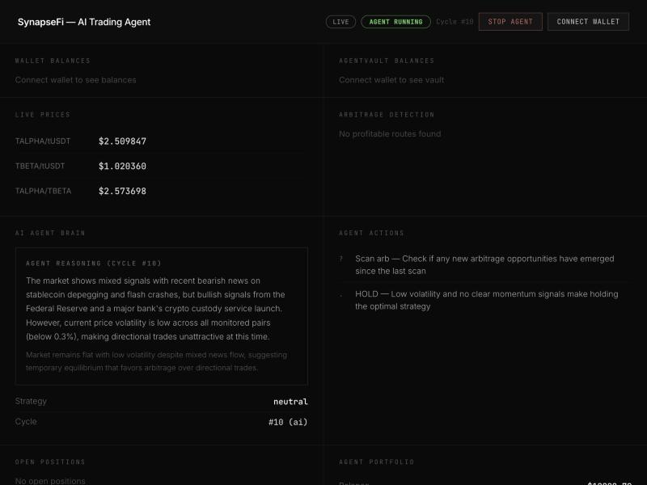
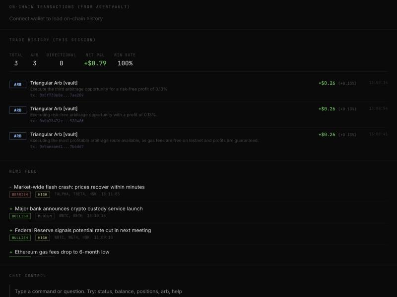

# TradeMinds — AI Agent Trading Bot on HashKey Chain

An autonomous AI-powered trading bot deployed on HashKey Chain (HSK). The AI agent monitors markets, reads news, detects triangular arbitrage, executes on-chain swaps through AgentVault, and manages risk — all without human intervention.

## Latest Test Results (Profit)

| Metric | Result |
|--------|--------|
| **Net Profit** | **+$0.79** |
| Win Rate | **100%** (3/3 trades) |
| Strategy | Triangular Arbitrage via AgentVault |
| Successful Txs | 3 on-chain arb transactions |
| Agent Cycles | 10 AI decision cycles |
| Losses | **0** |

### On-Chain Arb Transactions (Verifiable)

| # | Tx Hash | Profit | Route |
|---|---------|--------|-------|
| 1 | `0x9aeaaed1e3b3a701868121da2684fcd03dcc8783a2193a768d77e697227b6d67` | +$0.26 | tUSDT → TALPHA → TBETA → tUSDT |
| 2 | `0x0a78472e9adc2c6c452745edbb72ce770e92137ca84746d2a94b7157b852048f` | +$0.26 | TBETA → tUSDT → TALPHA → TBETA |
| 3 | `0x5f730e0ee0879c203b2ea651090b52a3b31271d19e88f2a9453ad1fe337ae209` | +$0.26 | TBETA → tUSDT → TALPHA → TBETA |

**How it works:** The agent exploits price discrepancies between 3 Uniswap V3 pools. The implied cross-rate from TALPHA/tUSDT and TBETA/tUSDT pools differs from the actual TALPHA/TBETA pool price by ~1.03%. After deducting 0.9% in pool fees (0.3% × 3 hops), the net profit is 0.13% per round trip. All trades are executed on-chain through AgentVault smart contract.

### Dashboard Screenshots


*Live dashboard showing AI agent reasoning (Cycle #10), real-time pool prices, and portfolio with +$0.79 P&L*


*Trade history showing 3 successful triangular arb trades via AgentVault, each with verifiable on-chain tx hash, 100% win rate*

## Dual-Mode Trading: Trading + Arbitrage in One Agent

This is not a separate trading bot and arb bot — it's **one unified AI agent** that does both simultaneously. Every decision cycle (~30s), the agent receives the full system state and can issue multiple actions at once:

- **Execute an arb route** while simultaneously **buying a token** on bullish news
- **Close a losing position** while **triggering a new arb scan**
- **Hold all positions** if the market is quiet — doing nothing is a valid strategy

The AI decides the optimal mix of trading and arbitrage based on real-time conditions. It doesn't follow rigid rules — it reasons through each situation and adapts.

## Features

### AI Agent Core
- **Autonomous Decision Making** — AI receives full system state (prices, portfolio, positions, news, arb opportunities) and outputs executable multi-step action plans
- **Chain-of-Thought Reasoning** — Every decision includes visible reasoning explaining the agent's logic, displayed live on the dashboard
- **Strategy Adaptation** — Agent dynamically switches between aggressive, defensive, and neutral strategies based on market conditions and recent performance
- **Dynamic Cycle Timing** — Agent decides its own check interval (15–120s) based on market activity

### On-Chain Trading (HSK Testnet)
- **Vault-Routed Swaps** — All trades routed through AgentVault for on-chain risk enforcement, with fallback to direct SwapRouter if vault is not deployed
- **Real Swap Execution** — Executes actual token swaps through Uniswap V3 SwapRouter on-chain
- **Triangular Arbitrage Execution** — Detects and executes 3-pool arb routes (e.g., tUSDT → TALPHA → TBETA → tUSDT) via multi-hop `exactInput`
- **Live Price Reads** — Reads real `slot0()` prices from deployed V3 pools every 5 seconds
- **Token Approval Management** — Automated ERC20 approval flow for all traded tokens
- **On-Chain Balance Tracking** — Reads real ERC20 wallet balances from chain

### Deployed Smart Contracts
- Full Uniswap V3 DEX deployed on HSK Testnet (Chain 133)
- **UniswapV3Factory** — Pool creation
- **SwapRouter** — Trade execution
- **NonfungiblePositionManager** — Liquidity management
- **AgentVault** — On-chain risk enforcement vault
- **3 Test Tokens** — TALPHA (18 dec), TBETA (18 dec), tUSDT (6 dec)
- **3 Liquidity Pools** — TALPHA/tUSDT, TBETA/tUSDT, TALPHA/TBETA

### Arbitrage Detection
- **Triangular Route Scanning** — Finds all profitable 3-pool cycles across deployed pools
- **Real-Time Profit Calculation** — Accounts for pool fees (0.3% per hop) and slippage
- **Auto-Execution** — Agent triggers arb when profitable routes are found

### News-Driven Trading
- **Simulated News Feed** — 28 crypto news templates with headline, sentiment, impact level, and affected tokens
- **Sentiment Analysis** — Bullish/bearish/neutral classification with high/medium/low impact scoring
- **News-Reactive Trading** — Agent factors news sentiment into buy/sell decisions with confidence adjustments
- **Real-Time News Display** — News feed on dashboard with sentiment tags

### AgentVault — On-Chain Risk Enforcement
- **Smart Contract Vault** — All trades routed through AgentVault.sol for on-chain safety
- **Owner/Agent Roles** — Owner deposits/withdraws/sets limits; agent can only execute trades through whitelisted router
- **Max Position Size** — On-chain enforcement of position size limits (configurable basis points)
- **Daily Loss Cap** — Contract-level daily loss accumulator prevents runaway losses
- **Cooldown Timer** — Configurable cooldown between trades to prevent rapid-fire execution
- **Agent Can Tighten Only** — Agent can reduce limits but never loosen them
- **Emergency Withdraw** — Owner can always withdraw, even when vault is paused
- **Pause/Unpause** — Both owner and agent can pause; only owner can unpause
- **21 Hardhat Tests** — Full test suite covering security, access control, limits, and events

### Chat Control — Natural Language Agent Interface
- **Command System** — Built-in commands: status, balance, positions, history, arb, limits, pause, resume, help
- **Natural Language** — Ask questions like "how is my portfolio doing?" or "why did you sell TALPHA?"
- **Pause/Resume Trading** — Control the agent directly from the chat panel
- **Agent Reasoning** — Ask "why" to see the agent's last decision reasoning
- **Real-Time Dashboard Panel** — Chat panel integrated into the web dashboard

### Risk Management
- **Position Sizing** — Max 5% of balance per position
- **Stop-Loss / Take-Profit** — Automatic position closure at configurable thresholds (3% SL, 5% TP)
- **Daily Loss Limit** — Trading halts at 2% daily drawdown
- **Max Open Positions** — Capped at 3 concurrent positions
- **Portfolio Tracking** — Real-time P&L, daily P&L, total trades, open/closed positions

### Live Dashboard
- **Real-Time Web UI** — Express server with Server-Sent Events (SSE) for instant updates
- **AI Brain Panel** — Shows agent's reasoning, strategy, and market assessment live
- **Portfolio Overview** — Balance, open value, P&L, trade count, on-chain balances
- **Price Display** — Live pool prices with auto-refresh
- **Arbitrage Monitor** — Detected routes with profit percentage and step-by-step paths
- **Position Tracker** — Open positions with entry/current price and unrealized P&L
- **News Feed** — Scrolling feed with sentiment badges and impact tags
- **Chat Control Panel** — Natural language interface to query and control the agent in real-time
- **Activity Log** — Chronological log of all agent actions and events
- **B/W Minimal Design** — Clean black/white theme with Inter + JetBrains Mono typography

### Market Maker
- **On-Chain Price Movement** — Separate script executes random swaps to create realistic price volatility
- **Configurable Intervals** — Adjustable swap frequency and amounts
- **Multi-Pool Coverage** — Trades across all 3 pools to create varied market conditions

## Architecture

```
┌─────────────────────────────────────────────────┐
│                   AI Agent Brain                 │
│         (Claude via OpenRouter API)              │
│                                                  │
│  Input: Full system state (prices, portfolio,    │
│         positions, arb, news, risk limits)       │
│                                                  │
│  Output: JSON action plan (trade, execute_arb,   │
│          close_position, adjust_risk, hold)       │
└──────────────────────┬──────────────────────────┘
                       │
          ┌────────────┼────────────┐
          ▼            ▼            ▼
   ┌────────────┐ ┌─────────┐ ┌─────────────┐
   │  Executor  │ │  Risk   │ │  Arb Engine │
   │ (on-chain) │ │ Manager │ │  (scanner)  │
   └─────┬──────┘ └────┬────┘ └──────┬──────┘
         │              │             │
         ▼              ▼             ▼
   ┌────────────────────────────────────────┐
   │         AgentVault Contract            │
   │  On-chain risk: max position, daily    │
   │  loss cap, cooldown, router whitelist  │
   └──────────────────┬─────────────────────┘
                      │
                      ▼
   ┌────────────────────────────────────────┐
   │      HSK Testnet (Chain 133)           │
   │  Uniswap V3 Pools + SwapRouter        │
   │  TALPHA/tUSDT | TBETA/tUSDT | A/B     │
   └────────────────────────────────────────┘
         │
         ▼
   ┌────────────────────────────────────────┐
   │     Dashboard (localhost:3456)         │
   │  Express + SSE + Chat Control Panel   │
   └────────────────────────────────────────┘
```

## Tech Stack

- **Blockchain** — HashKey Chain Testnet (EVM, Chain ID 133)
- **DEX** — Uniswap V3 (Factory, SwapRouter, NonfungiblePositionManager)
- **Smart Contracts** — Solidity 0.7.6 / 0.8.24 via Hardhat
- **AI** — Claude (via OpenRouter API)
- **Backend** — Node.js, Express, ethers.js v6
- **Frontend** — Single-page dashboard with SSE, Inter + JetBrains Mono fonts
- **Security** — OpenZeppelin (ReentrancyGuard, Pausable, SafeERC20)
- **Testing** — Hardhat + Chai (21 tests)
- **Tooling** — Hardhat, dotenv

## Setup

### Prerequisites
- Node.js 18+
- HSK testnet tokens (get from faucet)
- OpenRouter API key

### Install
```bash
npm install
```

### Configure
Create `.env`:
```env
NETWORK=testnet
MODE=live
AI_PROVIDER=openrouter
OPENROUTER_API_KEY=your-key-here
PRIVATE_KEY=your-wallet-private-key
SWAP_ROUTER=0xe4f185a337211019ac116f35267c932979Edd5e7
```

### Deploy Contracts (if needed)
```bash
npx hardhat run scripts/deploy_testnet_dex.js --network hsk_testnet
```

### Approve Tokens (one-time)
```bash
npm run approve
```

### Deploy AgentVault (if needed)
```bash
npm run deploy:vault
```

### Run Tests
```bash
npm run test:vault
```

### Add Liquidity (if needed)
```bash
node scripts/add_liquidity.js
```

## Usage

### Live Mode (On-Chain Execution)

Terminal 1 — Start market maker for price movement:
```bash
npm run market-maker
```

Terminal 2 — Start dashboard + trading bot:
```bash
npm run dashboard:live
```

Open `http://localhost:3456` to view the dashboard.

### Simulate Mode (Paper Trading)
```bash
npm run dashboard
```

### Chat Control

The dashboard includes a built-in chat panel. Type commands or ask naturally:

| Command | Description |
|---------|-------------|
| `status` | Portfolio overview with P&L |
| `balance` | Wallet + on-chain balances |
| `positions` | Open positions with unrealized P&L |
| `history` | Recent trade history |
| `arb` | Current arbitrage opportunities |
| `limits` | Risk management settings |
| `pause` | Pause the trading agent |
| `resume` | Resume the trading agent |
| `help` | List all commands |

Natural language also works: "how is my portfolio doing?", "why did you sell TALPHA?", "show me arb opportunities"

## Scripts

| Command | Description |
|---------|-------------|
| `npm run dashboard:live` | Dashboard + bot with on-chain execution |
| `npm run dashboard` | Dashboard + bot in simulate mode |
| `npm run market-maker` | On-chain price movement generator |
| `npm run approve` | Approve tokens for SwapRouter |
| `npm run agent:live` | CLI bot with on-chain execution (no dashboard) |
| `npm run agent` | CLI bot in simulate mode (no dashboard) |
| `npm run test:vault` | Run AgentVault smart contract tests |
| `npm run deploy:vault` | Deploy AgentVault to HSK testnet |

## Project Structure

```
├── dashboard.js          # Express dashboard + SSE + trading loop
├── index.js              # CLI entry point (no dashboard)
├── src/
│   ├── agent.js          # AI Agent orchestrator
│   ├── arb.js            # Triangular arbitrage detection
│   ├── chain.js          # RPC reader for V3 pools
│   ├── config.js         # Central configuration
│   ├── chat.js           # Chat control module (NL commands)
│   ├── executor.js       # Trade execution (vault + live + paper)
│   ├── history.js        # Price history + persistence
│   ├── news.js           # Simulated news feed
│   ├── risk.js           # Risk management + balance tracking
│   └── simulator.js      # Price movement overlay (simulate mode)
├── scripts/
│   ├── approve_tokens.js # One-time token approvals
│   ├── market_maker.js   # On-chain random swap generator
│   ├── add_liquidity.js  # Pool liquidity management
│   ├── deploy_vault.js   # AgentVault deployment + token deposit
│   └── deploy_testnet_dex.js  # Full DEX deployment
├── test/
│   └── AgentVault.test.js     # 21 vault contract tests
├── contracts/            # Solidity contracts (AgentVault, MockERC20, WETH9)
├── testnet_deployment.json    # Deployed contract addresses
└── .env                  # Environment configuration
```

## Historical Test Results (HSK Testnet)

Earlier 5-minute live test on HSK Testnet with market maker generating on-chain price movement:

| Metric | Result |
|--------|--------|
| Duration | 5 minutes |
| Agent Cycles | 18 |
| Arb Executions | 5 on-chain transactions |
| Arb Failures | 0 |
| Market Maker Swaps | 14 on-chain swaps |
| Starting Balance | $10,000.00 |
| Final Balance | $10,120.06 |
| **Total Profit** | **+$120.06 (+1.2%)** |
| Strategy Used | Defensive (bearish news → arb only) |

The AI agent autonomously detected bearish market conditions (flash crash, stablecoin depegging news, sell walls) and switched to a defensive strategy — executing only risk-free triangular arbitrage while avoiding directional trades. All trades routed through AgentVault on-chain.

### On-Chain Arb Transaction Hashes

| # | Transaction Hash |
|---|-----------------|
| 1 | `0x06a46cc85beea5fad2c848d77ad2376694a57349c8363db3f2e5b4c6c3bf096e` |
| 2 | `0xf6ee5e687fe976aeb8ea521fd56443691c125a1529873fab8333fd752f5cae1f` |
| 3 | `0x33b4bafc7c0c87ca0124429a93fae2e9a61398cc508d3448f9f873449090b214` |
| 4 | `0xcc876f4c73de5fd785e40cf892ee44c9f92205415de839b84e8600f8867da5b3` |
| 5 | `0x3574a5319c283f33f58fca636cc38c3b8c47ceba29f7542ad1370a7a0925a3e3` |

Arb route: tUSDT → TALPHA → TBETA → tUSDT (triangular, 3 hops via Uniswap V3 pools)

### Live Trading Session (Arb + Directional)

Second session demonstrating both arbitrage and AI-driven directional trading:

| # | Type | Transaction Hash | Detail |
|---|------|-----------------|--------|
| 6 | ARB | `0x18691be038156c4adc0db34a3366f278be58873c9ee7e8b86adcfc502b287d8e` | tUSDT → TALPHA → TBETA → tUSDT, +$4.19 (0.42%) |
| 7 | BUY | `0x5f4cc05cf48ea4af0a4387a59ce5322865d73c7aeb1237b3557a59b73b8d1aab` | BUY TALPHA @ $2.577 via AgentVault (bullish accumulation news) |

AI agent detected TALPHA accumulation pattern (bullish news) and shifted to aggressive strategy — executing both arbitrage for risk-free profit and a directional TALPHA buy based on market sentiment. All trades routed through AgentVault on-chain.

## Deployed Contracts (HSK Testnet)

| Contract | Address |
|----------|---------|
| Factory | `0xB862231b343231E456DF47E520b57e32AE079dD6` |
| SwapRouter | `0xe4f185a337211019ac116f35267c932979Edd5e7` |
| NPM | `0x628f0750881A90eB26bd30775E00a3eB3811dbb5` |
| TALPHA | `0x747e0179896617E3AcEC745BEEb22696fc849848` |
| TBETA | `0xe326f0606E27c34a29DEB9E72a0cCdecA6cA6593` |
| tUSDT | `0x7de25caAc85194219bAbbDC2106c49fF91784cB6` |
| AgentVault | `0xd980018422ee5b535e107b0Feb66a04438d30a4e` |

### Liquidity Pools

| Pool | Address |
|------|---------|
| TALPHA/tUSDT | `0x6133D76B308556eE4115B5ED2BD59c03f260867a` |
| TBETA/tUSDT | `0x3cA388AC01b332b09EFC00D87eBFDDFdA0749Bc2` |
| TALPHA/TBETA | `0xC28Cb933EE9411e6B5e18736CbacF2d01c9D263d` |

## License

MIT
